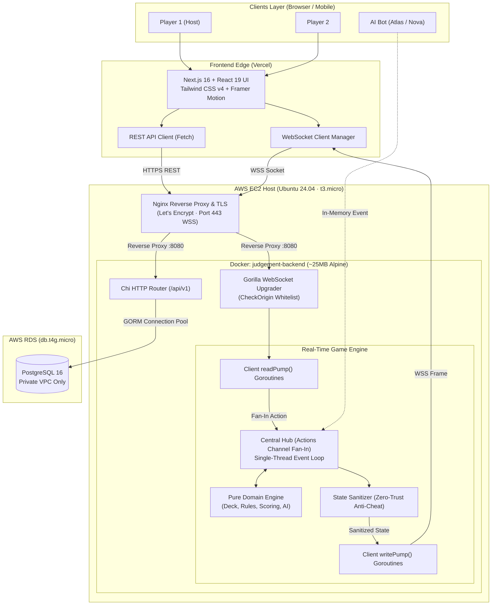
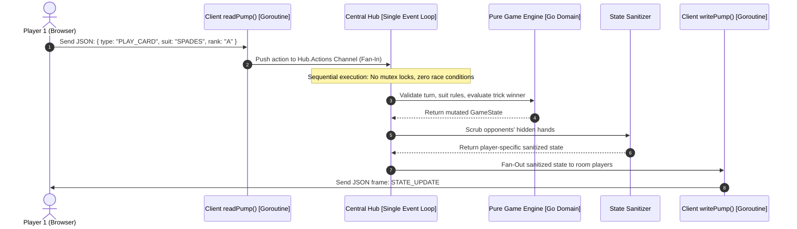

# 🃏 Judgement Card Game — Complete Interview Study Guide

<div align="center">


**An enterprise-grade, real-time multiplayer trick-taking card game engine with zero-trust security and sub-millisecond concurrency.**

[🌐 Production App](https://judgement-game-gamma.vercel.app) • [🔌 API & WebSocket Host](https://judgement-game-api.duckdns.org) • [📖 Architecture](#3-system-architecture--concurrency-model) • [❓ 20 Interview Q&As](#8-20-curated-interview-questions--answers)

---

</div>

## 📑 Table of Contents
1. [The 30-Second Elevator Pitch](#1-the-30-second-elevator-pitch)
2. [Problem Statement & Game Mechanics](#2-problem-statement--game-mechanics)
3. [System Architecture & Concurrency Model](#3-system-architecture--concurrency-model)
4. [Tech Stack Breakdown (Why This Tech?)](#4-tech-stack-breakdown-why-this-tech)
5. [Key Technical Challenges & Real-World Fixes](#5-key-technical-challenges--real-world-fixes)
6. [Cons, Limitations & Architectural Trade-offs](#6-cons-limitations--architectural-trade-offs)
7. [Key Performance Metrics & Highlights](#7-key-performance-metrics--highlights)
8. [20 Curated Interview Questions & Answers](#8-20-curated-interview-questions--answers)
   - [Category A: Concurrency & Go Internals (Q1–Q5)](#category-a-concurrency--go-internals)
   - [Category B: WebSockets & Networking (Q6–Q8)](#category-b-websockets--networking)
   - [Category C: Security & Anti-Cheat (Q9–Q11)](#category-c-security--anti-cheat)
   - [Category D: System Design & Scalability (Q12–Q15)](#category-d-system-design--scalability)
   - [Category E: Cloud, DevOps & Infrastructure (Q16–Q18)](#category-e-cloud-devops--infrastructure)
   - [Category F: Game Domain Logic & Frontend (Q19–Q20)](#category-f-game-domain-logic--frontend)
9. [Interview Delivery Tips (The STAR Framework)](#9-interview-delivery-tips-the-star-framework)

---

## 1. The 30-Second Elevator Pitch

> [!TIP]
> **Use this concise narrative when an interviewer says: *"Walk me through this project."***

```text
"Judgement is a real-time multiplayer card strategy game built with a Go backend and a Next.js 16 
(React 19) frontend. In Judgement, players must predict the exact number of tricks they'll win, 
penalizing over-winning or under-winning with 0 points.

To solve simultaneous card-play race conditions, I built a lock-free Go concurrency engine where 
player WebSockets fan-in to a single sequential event channel, completely eliminating data races 
without mutex contention. It features zero-trust anti-cheat hand scrubbing, heuristic AI sparring bots, 
a hybrid guest/registered auth model, and a production AWS deployment on EC2 and RDS with CI/CD 
via GitHub Actions."
```

---

## 2. Problem Statement & Game Mechanics

### Core Game Rules (Judgement / Kachuful)
Unlike casual card games where players simply maximize tricks won, Judgement is a game of **exact contract forecasting**:

| Phase | Core Mechanism | Engineering & Rule Constraint |
| :--- | :--- | :--- |
| **1. Deal & Trump** | Cards are dealt evenly based on round size. A trump suit (Hukum) is selected. | Dynamic card decrementing round-by-round (e.g. 13 down to 1). |
| **2. Bidding** | Each player bids the exact number of tricks they forecast they will win. | **The Dealer Constraint**: The sum of all player bids cannot equal total cards dealt. At least one player is mathematically guaranteed to fail. |
| **3. Trick Play** | Players take turns playing one card clockwise. | **Strict Suit-Following**: A player must follow the lead suit if they hold a matching card. Only off-suit voids allow trump cutting or discarding. |
| **4. Trick Winner** | Highest trump card wins; if no trump, highest card of lead suit wins. | Winner collects trick and leads the subsequent trick. |
| **5. Scoring** | Exact bid met = `10 + Bid` points; any over/under deviation = `0` points. | Strict cumulative score persistence across rounds. |

### Technical Problems Solved
* **Concurrent State Mutation**: Preventing two players from playing cards at the exact same millisecond and corrupting in-memory game state.
* **Client-Side Data Snooping**: Ensuring players cannot open browser DevTools to read opponents' cards from WebSocket network packets.
* **Onboarding Drop-off vs. Progression**: Allowing instant 1-click guest play without database bloat, while still recording permanent win/loss stats for registered users.
* **Persistent Sockets vs. Serverless**: Eliminating 50-second serverless cold-start pauses by deploying a dedicated containerized Go instance on AWS.
* **Sub-Millisecond AI Opponents**: Engineering rule-compliant heuristic AI bots without expensive, high-latency (1–3s) LLM API calls.

---

## 3. System Architecture & Concurrency Model

The platform uses a **Clean Hexagonal Architecture**, isolating stateless transactional HTTP (auth, lobby CRUD) from stateful, low-latency WebSocket game loops.

### High-Level Architecture Diagram



### Concurrency Flow: Goroutine Fan-In / Fan-Out



---

## 4. Tech Stack Breakdown (Why This Tech?)

| Component | Selected Technology | Why Chosen? | Alternative Considered & Why Rejected |
| :--- | :--- | :--- | :--- |
| **Backend Language** | **Go (Golang 1.26)** | Lightweight goroutines (~2KB overhead vs ~1MB OS threads); fast compilation; ~35MB RAM footprint; memory safety. | **Node.js**: Single thread blocks on heavy CPU trick logic; **Java**: Exceeds AWS free-tier RAM limits (>300MB). |
| **HTTP Routing** | **go-chi/chi/v5** | Standard library compatibility (`net/http`); zero allocations; composable middleware pipeline. | **Gin / Fiber**: Fiber uses non-standard `fasthttp` which breaks standard `http.Hijacker` needed for WebSockets. |
| **Real-Time Engine** | **gorilla/websocket** | Standard RFC 6455 implementation; granular control over frame buffers, heartbeats, and socket hijacking. | **Socket.io**: Heavy protocol abstraction; adds unnecessary client-side bundle weight. |
| **Frontend Framework**| **Next.js 16 (React 19)** | App Router with Server Components; fast initial page render; native TypeScript 5 support. | **Pure Vite SPA**: Lacks server-side rendering for SEO, metadata, and dynamic link previews. |
| **Styling & UI** | **Tailwind CSS v4 + DaisyUI** | Atomic utility-first CSS; zero runtime CSS-in-JS performance penalty; tactical obsidian/cyan visual theme. | **MUI / AntD**: Heavy bundle overhead; opinionated enterprise layouts unsuitable for card game arenas. |
| **Motion & Physics** | **Framer Motion 13** | Hardware-accelerated 60fps animations for card dealing, hover elevations, trick collection, and confetti. | **Pure CSS**: Extremely cumbersome to orchestrate dynamic coordinate transitions across trick winners. |
| **Database** | **PostgreSQL 16 (AWS RDS)** | ACID compliance; relational integrity for user accounts, lobbies, and match histories; automated snapshots. | **MongoDB**: Overkill for relational user/lobby entities; lacks strict foreign-key cascading. |
| **Compute / Host** | **AWS EC2 (`t3.micro`) + Nginx** | Persistent 24/7 compute; zero cold starts; dedicated WebSocket process; fits AWS Free Tier. | **AWS Lambda / Vercel Serverless**: Ephemeral containers terminate connections; 50s cold-start delays. |
| **Reverse Proxy / SSL**| **Nginx + Let's Encrypt** | TLS 1.3 offloading; handles HTTP to WebSocket upgrades; buffers Slowloris attacks; automated renewal via Certbot. | **Direct Go Exposure**: Requires root privileges to bind 80/443; lacks reverse proxy connection buffering. |
| **CI/CD** | **GitHub Actions + AWS ECR** | Automated tests; builds Docker images on GitHub cloud runners (preserving EC2 CPU/RAM); 1.5s SSH deploy swap. | **Building on EC2**: Saturated CPU burst credits and triggered Linux OOM Killer on 1GB RAM instance. |

---

## 5. Key Technical Challenges & Real-World Fixes

### 1. The Go Channel Double-Close Panic Race Condition
* **Symptom**: Under unstable network disconnects, the server crashed with fatal runtime error: `panic: close of closed channel`.
* **Root Cause**: `client.Send` was closed during unregistration. If a concurrent broadcast operation hit a write error on the same client, it attempted to close `client.Send` a second time.
* **Resolution**: Encapsulated channel teardown inside `client.CloseSend()` using Go’s `sync.Once`. This guarantees `close(c.Send)` executes exactly once across all goroutines.

### 2. Chi Router `middleware.Timeout` Stripping `http.Hijacker`
* **Symptom**: WebSocket connection failed with `1006` or `500 Internal Server Error` during the upgrade handshake.
* **Root Cause**: Chi’s global `middleware.Timeout` wraps `http.ResponseWriter` in a custom `timeoutWriter` that implements `http.ResponseWriter` and `http.Flusher`, but **does NOT implement `http.Hijacker`**. Gorilla WebSocket's `w.(http.Hijacker)` type assertion failed.
* **Resolution**: Removed `middleware.Timeout` from the global middleware chain, preserving raw TCP socket hijacking for WebSocket routes.

### 3. Serverless Cold Starts vs. Dedicated Cloud Architecture
* **Symptom**: On free-tier PaaS environments, leaving the application idle for 15 minutes caused subsequent API and WebSocket requests to hang for 50+ seconds.
* **Root Cause**: Ephemeral serverless containers de-provision when idle, terminating persistent TCP connections.
* **Resolution**: Migrated the Go backend to an **AWS EC2 `t3.micro` instance** running Docker behind Nginx with an Elastic IP. The backend runs 24/7 with zero cold starts and sub-5ms local processing.

### 4. Client-Side DevTools Inspection (Anti-Cheat Sanitization)
* **Symptom**: Naive WebSocket broadcasting sent full `GameState` payloads to all players, allowing opponents to view hidden hands via the Chrome DevTools Network tab.
* **Root Cause**: Lack of server-side data scrubbing before network serialization.
* **Resolution**: Implemented zero-trust state sanitization in `internal/game`. Before sending state frames, the server deep-clones the game state and wipes out opponents' card arrays, returning only public table cards and hand card counts.

### 5. Cumulative Scoring Overwrite on Consecutive Rounds
* **Symptom**: When a host clicked "Play Next Round", all player scores unexpectedly reset to zero.
* **Root Cause**: In `hub.go`, `EventStartGame` blindly called `game.NewGame()`, which destroyed the existing `GameState` struct and wiped the `Scores` map.
* **Resolution**: Refactored round initialization to verify if a `GameState` pointer already existed for that lobby. If found, the engine reuses the struct, preserving cumulative `Scores`, and only resets round-specific attributes (`Hands`, `Bids`, `TricksWon`).

### 6. Out-Of-Memory (OOM) Crashes on 1GB RAM EC2
* **Symptom**: Docker layer decompression and image builds on EC2 triggered the Linux Out-Of-Memory (OOM) Killer, terminating the Go server.
* **Root Cause**: EC2 `t3.micro` has only 1024 MB RAM. Memory spikes during builds pushed usage over physical limits.
* **Resolution**: 
  1. Configured a **2GB Swapfile** on the EC2 NVMe/gp3 EBS volume to absorb sudden memory peaks gracefully.
  2. Offloaded Docker builds to GitHub Actions cloud runners, pulling only pre-compiled, stripped multi-stage Alpine images (~25MB) to EC2.

### 7. Hybrid Authentication & Cryptographic Guest IDs
* **Challenge**: Guests needed instant 1-click play without clogging PostgreSQL with junk accounts, while registered users required permanent win/loss tracking.
* **Resolution**: 
  - Registered users receive auto-incrementing positive IDs (`1, 2, 3...`) stored in Postgres.
  - Guests receive cryptographically secure negative IDs (range `-100,000,000` to `-999,999,999`) generated via Go’s `crypto/rand`.
  - Both receive signed JWTs with `is_guest: bool`. The database and in-memory game logic instantly distinguish guest players with zero ID collisions.

---

## 6. Cons, Limitations & Architectural Trade-offs

> [!NOTE]
> **Articulating architectural trade-offs demonstrates senior engineering maturity.**

| Current Boundary | Why We Made This Choice | Next-Gen Production Solution |
| :--- | :--- | :--- |
| **In-Memory Game State** | Kept in server RAM for sub-millisecond execution without DB latency. If the EC2 server crashes, active matches are lost. | Snapshot game state to an in-memory **Redis cluster** or write-behind PostgreSQL store after each completed trick. |
| **Single-Node Scaling Limit** | Singleton Hub runs on one EC2 instance (~10,000 concurrent sockets capacity). Rooms cannot span multiple servers. | Introduce **Redis Pub/Sub** message broker to distribute game room events across a fleet of Go backend containers behind an ALB. |
| **Dynamic DNS Reputation** | Used free DuckDNS (`duckdns.org`) for Elastic IP binding. Some aggressive ad-blockers (uBlock Origin) block dynamic DNS domains. | Register a custom top-level domain (e.g. `judgementgame.com`) with Amazon Route 53 and AWS Certificate Manager (ACM). |
| **Heuristic AI vs. ML** | AI bots use rule-based heuristics (<1ms evaluation). Fast and deterministic, but bots cannot perform multi-round psychological bluffing. | Train a lightweight Reinforcement Learning model or Monte Carlo Tree Search (MCTS) exported to ONNX Runtime. |
| **Transient Socket Reconnect** | Short disconnects recover if socket reconnects, but lacks long-lived session leases across server restarts. | Implement a Redis-backed session token with a 60-second reconnection grace buffer. |

---

## 7. Key Performance Metrics & Highlights

<div align="center">

| Metric | Measured Value | Benefit |
| :--- | :--- | :--- |
| **Production Binary Size** | **~25 MB** (Alpine Multi-Stage) | Ultra-fast CI/CD deployment; minimal attack surface |
| **Idle Memory Consumption** | **~35 MB RAM** (Go Runtime) | Runs reliably on low-cost AWS `t3.micro` instance |
| **Turn Processing Latency** | **< 5 ms** (Go Channel Fan-In) | Immediate, responsive trick evaluation |
| **CI/CD Deployment Swap** | **< 1.5 seconds** (Docker Swap) | Zero perceptible downtime during updates |
| **Server Cold Start** | **0 ms** (Dedicated 24/7 EC2) | Persistent WebSocket connections never drop |
| **Core Logic Test Coverage** | **100% Domain Coverage** | Pure Go logic tested with zero network mocks |

</div>

---

## 8. 20 Curated Interview Questions & Answers

### Category A: Concurrency & Go Internals

#### Q1: Why did you choose Go over Node.js or Python for this real-time game engine?
> [!NOTE]
> **Key Takeaway**: Goroutines cost ~2KB vs ~1MB for OS threads, and Go distributes CPU work across all cores without blocking an event loop.

* **Concurrency Model**: Go spawns lightweight green threads (goroutines) with ~2KB initial stacks, allowing us to comfortably maintain two dedicated goroutines per connected player (`readPump` and `writePump`) for thousands of concurrent players.
* **Predictable CPU Performance**: Trick-taking games require constant CPU evaluations (dealer constraint validation, trick winner calculation, AI heuristics). In Node.js, heavy loops can block the single-threaded event loop, introducing jitter for all other sockets. Go distributes work across all CPU cores via the Go runtime M:N scheduler.
* **Minimal Resource Footprint**: Go compiles to a static binary. The production container uses ~35MB of RAM, making it ideal for cost-efficient AWS deployment.

#### Q2: How does your backend prevent race conditions when multiple players play a card simultaneously?
> [!NOTE]
> **Key Takeaway**: We follow Go's mantra: *"Do not communicate by sharing memory; instead, share memory by communicating."*

* Instead of using complex `sync.Mutex` locks across multiple threads, all player `readPump()` goroutines push incoming actions into a single unbuffered Go channel (`Hub.Actions`).
* The Central Hub runs a single, dedicated sequential `select` loop that processes one card play at a time.
* Because only one goroutine ever mutates the active `GameState` struct at any given moment, data races, deadlocks, and lock contention are mathematically impossible.

#### Q3: What is the difference between buffered and unbuffered channels in Go, and where did you use each?
* **Unbuffered Channels (`capacity = 0`)**: A send operation blocks until another goroutine receives from it, enforcing synchronous handoff. We use this for `Hub.Actions` so actions are processed in strict chronological order.
* **Buffered Channels (`capacity > 0`)**: Sends only block when the buffer is full. We use buffered channels (`client.Send`, capacity 256) for outgoing WebSocket frames so a slow client network does not block the Central Hub loop. If a client's buffer fills up, the Hub drops the connection to protect overall server health.

#### Q4: What is the Go `sync.Once` construct and why was it necessary in your WebSocket client?
* In Go, closing an already closed channel triggers a fatal, unrecoverable runtime panic (`panic: close of closed channel`).
* Under unstable network conditions, both a socket read failure in `readPump()` and a failed broadcast write in the Hub could attempt to unregister and close `client.Send` simultaneously.
* By encapsulating channel closure in `client.CloseSend()` with `sync.Once`, the Go runtime guarantees that `close(c.Send)` executes exactly once, regardless of how many goroutines invoke it concurrently.

#### Q5: What is the role of Go’s M:N scheduler in this application?
* Go's runtime uses an M:N scheduler that multiplexes $M$ goroutines onto $N$ OS kernel threads using a work-stealing algorithm.
* When a player's `readPump()` blocks waiting for incoming network bytes, the Go runtime automatically parks that goroutine and context-switches the underlying OS thread to run another active task.
* This allows our Go server to hold thousands of persistent WebSocket connections simultaneously with virtually zero OS thread context-switching overhead.

---

### Category B: WebSockets & Networking

#### Q6: Explain the WebSocket handshake process. Why did Chi's `middleware.Timeout` break it?
* A WebSocket connection initiates as a standard HTTP/1.1 `GET` request with headers: `Upgrade: websocket`, `Connection: Upgrade`, and a base64 nonce `Sec-WebSocket-Key`. If accepted, the server responds with `HTTP 101 Switching Protocols` and hijacks the raw TCP socket.
* In Go, socket hijacking requires the `http.ResponseWriter` to implement the `http.Hijacker` interface (`Hijack() (net.Conn, *bufio.ReadWriter, error)`).
* Chi's global `middleware.Timeout` wrapped the response writer in a custom `timeoutWriter` struct that implemented `ResponseWriter` and `Flusher`, but **omitted `Hijacker`**. When Gorilla WebSocket tried to cast `w.(http.Hijacker)`, the type assertion failed, aborting the handshake with HTTP 500. We resolved this by removing timeout middleware from real-time WebSocket routes.

#### Q7: What is Cross-Site WebSocket Hijacking (CSWSH) and how did you prevent it?
* Unlike standard AJAX/Fetch requests, WebSockets are **not bound by the browser's Same-Origin Policy (SOP)**. A malicious site (`evil.com`) can silently open a WebSocket connection to `wss://judgement-game-api.duckdns.org`, and the browser will attach existing cookies/credentials.
* To prevent CSWSH, we implemented strict allowlist origin validation (`isAllowedOrigin`) in Gorilla's `CheckOrigin` callback. It inspects the HTTP `Origin` header and rejects any connection that does not originate from `https://judgement-game-gamma.vercel.app` or approved development URLs with an `HTTP 403 Forbidden`.

#### Q8: Why did you place an Nginx reverse proxy in front of the Go backend instead of exposing port 8080 directly?
* **TLS 1.3 Termination**: Nginx offloads cryptographic handshakes and integrates with Certbot for automated Let's Encrypt renewal, keeping Go CPU cycles dedicated to game logic.
* **Security & Non-Root Execution**: Binding to privileged ports (80/443) directly in Go requires root privileges. Nginx handles standard ports, allowing our Go container to run under an unprivileged user (`appuser`, UID 10001).
* **Slowloris & Connection Buffering**: Nginx buffers slow or malformed client connections, protecting Go from socket exhaustion attacks.
* **Persistent Timeouts**: We configured `proxy_read_timeout 3600s` and `proxy_send_timeout 3600s` so active card games are not dropped during natural player pauses.

---

### Category C: Security & Anti-Cheat

#### Q9: How does the system prevent players from seeing opponents’ cards using browser DevTools?
* The architecture enforces **Zero-Trust State Sanitization**.
* The server maintains the true global game state in RAM. Before serializing `GameState` to JSON for WebSocket transmission, the Hub calls `SanitizeForPlayer(playerID)`.
* This deep-clones the game state and wipes out all opponents' card arrays, sending only public table data, scores, and the requesting player's own hand. Opponents' cards physically do not exist in the client network packet.

#### Q10: How are passwords stored, and how does JWT authentication work in this architecture?
* **Passwords**: Hashed using `bcrypt` with a cost factor of 10. Passwords are never stored in plaintext.
* **JWTs**: The server issues HMAC-SHA256 signed JWTs containing `user_id`, `username`, and `is_guest` with a 72-hour validity window. Protected REST endpoints validate the `Bearer <token>` header in `AuthMiddleware`. For WebSockets, the token is validated as a query parameter during the initial HTTP upgrade request.

#### Q11: How do you protect your REST endpoints against Denial-of-Service (DoS) memory exhaustion?
* Standard Go `json.NewDecoder(r.Body)` reads unbounded input streams into memory. An attacker could stream a 500MB JSON payload to crash the server.
* We wrapped all JSON request parsing with `http.MaxBytesReader(w, r.Body, 1048576)`, enforcing a strict **1 MB hard limit** on all incoming payloads. Furthermore, usernames (2–20 chars) and passwords (6–72 chars) are strictly validated with regex bounds.

---

### Category D: System Design & Scalability

#### Q12: Why not deploy the Go backend on AWS Lambda + API Gateway WebSockets?
* AWS Lambda is stateless and ephemeral. In Judgement, the server maintains persistent in-memory goroutines tied directly to active TCP sockets, fanning into a shared in-memory channel to guarantee atomic state transitions.
* Deploying to Lambda would require serializing and deserializing the entire `GameState` to an external Redis store on every card play, along with distributed optimistic locking (`WATCH`/`MULTI` or Redlock). This would introduce high network latency and cloud costs. A persistent container on EC2 is the superior architectural choice.

#### Q13: If this game scales to 100,000 concurrent players, what architecture would you transition to?
* **Distributed Pub/Sub (Redis / Dragonfly)**: Replace the singleton in-memory Hub with a Redis Pub/Sub message broker so lobby state changes sync across multiple server instances.
* **Session Affinity / Room Routing**: Use an Application Load Balancer (ALB) or Envoy proxy with consistent hashing on `LobbyID`, ensuring all 4 players in a match connect to the same server node.
* **Container Orchestration**: Migrate from single EC2 to **AWS ECS Fargate**, autoscaling tasks based on active WebSocket connection metrics.
* **Database Scaling**: Add **AWS RDS Read Replicas** for leaderboard and profile queries, fronted by **AWS RDS Proxy** or **PgBouncer** for connection pooling.

#### Q14: How does connection pooling work in GORM with PostgreSQL?
* Opening a new TCP/TLS connection to PostgreSQL for every HTTP request is prohibitively expensive.
* In `backend/internal/database/db.go`, GORM wraps Go's `database/sql` connection pool. On application startup, a pool of persistent connections is established. When an HTTP handler queries the database, it borrows an idle connection from the pool and immediately returns it upon query completion. During server shutdown, `sqlDB.Close()` is called to prevent orphaned database connections on RDS.

#### Q15: How does the Hybrid Authentication model handle guest accounts without polluting the database?
* Guests invoke `POST /api/v1/auth/guest`. The backend generates a cryptographically secure **negative integer ID** (between `-100,000,000` and `-999,999,999`) using Go’s `crypto/rand` package.
* The guest receives a signed JWT with `is_guest: true`. Because guest IDs are always negative and registered users have positive auto-incrementing IDs (`1, 2, 3...`), the system can uniquely identify and seat guests at game tables without writing temporary junk records to PostgreSQL.

---

### Category E: Cloud, DevOps & Infrastructure

#### Q16: Explain the multi-stage Docker build in `backend/Dockerfile`. Why is it critical?
* **Builder Stage (`golang:alpine`)**: Compiles Go source code with stripped debug symbols: `go build -ldflags="-w -s" -o server ./cmd/api`.
* **Production Stage (`alpine:3.20`)**: A bare ~5MB Alpine image. We copy only the compiled binary and root CA certificates, create an unprivileged user (`appuser`, UID 10001), and set `USER appuser`.
* **Benefits**: The final container is only ~25MB, contains no Go compiler, package manager, or git (dramatically reducing the attack surface), and pulls in seconds during CI/CD.

#### Q17: Why build Docker images in GitHub Actions rather than directly on the EC2 instance?
* Our production EC2 instance is a `t3.micro` with 1 vCPU and 1 GB of RAM. Running `docker build` (downloading Go packages, compiling code, compressing filesystem layers) would exhaust the instance’s CPU burst credits and cause RAM exhaustion, freezing the server and dropping active card games.
* GitHub Actions provides 2-core, 7 GB RAM cloud runners for free, building and pushing the image to AWS ECR in seconds. The EC2 instance merely executes a fast `docker pull` and container swap.

#### Q18: What is an AWS Security Group, and how did you configure Defense-in-Depth for RDS?
* An AWS Security Group acts as a stateful virtual firewall at the hypervisor layer.
* **RDS Public Access is Disabled**: The PostgreSQL instance has no public IP address and cannot be reached from the internet.
* **Security Group Referencing**: Rather than allowing IP ranges, `rds-judgement-sg` has a single inbound rule on port 5432 that strictly references the **Security Group ID of the EC2 instance (`ec2-judgement-sg`)**. Only traffic originating from our backend EC2 instance can reach the database.

---

### Category F: Game Domain Logic & Frontend

#### Q19: How did you design the AI sparring bots without using LLM APIs?
* Using LLM APIs for real-time card games introduces 1–3s latency, recurring API costs, and risk of illegal moves. Instead, we engineered a deterministic **Heuristic Decision Engine** (`internal/game/ai.go`):
* **Bidding Phase**: Bots analyze their hand for high-card honor values (Aces, Kings), trump count, and side-suit voids to calculate expected tricks. Three distinct personas (**Atlas** - conservative, **Nova** - aggressive, **Sage** - balanced) apply different risk multipliers.
* **Card Play Phase**: The bot filters hand cards through `getLegalCards` to guarantee rule adherence (e.g. must follow lead suit). If the bot has met its bid contract, it deliberately plays its lowest card to avoid winning unwanted tricks. If it still needs tricks, it plays the minimum winning trump or lead card.
* An asynchronous 800ms goroutine delay simulates natural human deliberation.

#### Q20: What was the root cause of descender clipping in Tailwind CSS gradient text, and how did you fix it?
* Applying `-webkit-background-clip: text` and `-webkit-text-fill-color: transparent` clips the background strictly to the element's CSS line-box. In letters with descenders (`g`, `y`, `p`, `q`, `j`), the bottom tails fall below the baseline and are horizontally clipped.
* We resolved this globally in `globals.css` by applying `display: inline-block; padding-bottom: 0.15em; line-height: 1.2;` to all text-gradient classes. This expands the clip boundary and ensures crisp, unclipped typography across all screen resolutions.

---

## 9. Interview Delivery Tips (The STAR Framework)

When presenting this project, structure your answers using the **STAR Method**:

```
┌────────────────────────────────────────────────────────────────────────┐
│ SITUATION: "In Judgement, multiple players can play cards at the exact  │
│ same millisecond over WebSockets, risking data races."                 │
├────────────────────────────────────────────────────────────────────────┤
│ TASK: "I needed to ensure strict sequential execution without mutex    │
│ contention or freezing the server."                                    │
├────────────────────────────────────────────────────────────────────────┤
│ ACTION: "I implemented a Go channel Fan-In pattern where player read   │
│ pumps serialize actions into an unbuffered Central Hub channel."       │
├────────────────────────────────────────────────────────────────────────┤
│ RESULT: "Zero race conditions in stress tests, sub-5ms action latency, │
│ and an engine that handles thousands of sockets on 35MB RAM."          │
└────────────────────────────────────────────────────────────────────────┘
```

### 💡 High-Impact Keywords to Naturally Mention
`Goroutine Fan-In / Fan-Out` • `Zero-Trust State Sanitization` • `Gorilla WebSockets` • `RFC 6455 Socket Hijacking` • `Cross-Site WebSocket Hijacking (CSWSH)` • `sync.Once Teardown` • `Heuristic Game Engine` • `Multi-Stage Alpine Docker` • `Defense-in-Depth RDS Isolation` • `Next.js 16 App Router` • `Let's Encrypt ACME Challenge` • `Connection Pooling`
